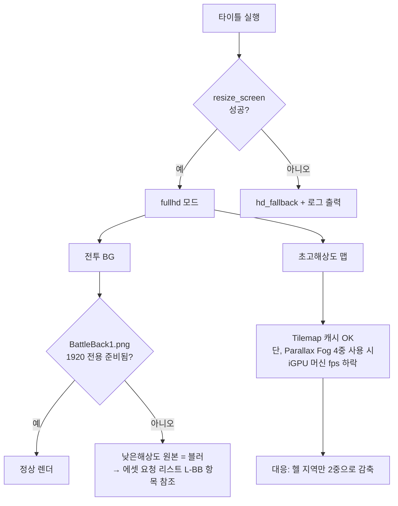
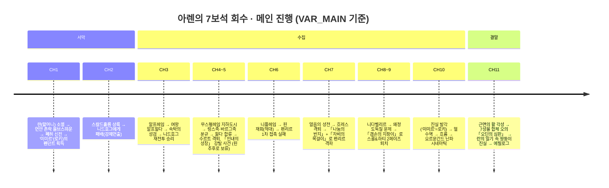

# AGENTS.md — THRTZ (RPG Maker VX Ace project)

항상 한국어로 대답해
The working directory C:\THRTZ is an **RPG Maker VX Ace 1.02 game project**.

## What lives here
- Game assets: `Audio/`, `Graphics/`, `Movies/`, plus editor files `Game.rvproj2`, `Game.ini`, `Game.exe`.
- `Data/*.rvdata2` — engine state, serialized as **Marshal Ruby objects** (binary). NOT plain text; do not hand-edit. Only safe to change via the AI toolkit below or the editor.
- `System/RGSS301.dll` — VX Ace runtime library.
- `RPG-Maker-AI-Toolkit-Multi-Platform/` — **the only code repo** (own git repo). An MCP server that edits `.rvdata2` through 12 macro tools.

## Where to work
- Almost all agent work happens in `RPG-Maker-AI-Toolkit-Multi-Platform/`. It has its **own `AGENTS.md` + `.gitignore` + `.env`** — read those before touching it. Do NOT copy root conventions into it.

## Edit the game data only through the toolkit
- Do not write to `Data/*.rvdata2`, `System/RGSS334.dll`, or other binary files directly.
- `RPG-Maker-AI-Toolkit-Multi-Platform/` is the tool for editing engine data; it auto-backs up before every write, validates input, and appends to a change log.

## Pitfalls
- `.rvdata2` files are binary — committing them or diffing them is meaningless to code review; edit via the toolkit, not patch text.
- Engine default is `mz`; this project is **`vxace`** — set `RPGMAKER_ENGINE=vxace` when running the toolkit.

Behavioral guidelines to reduce common LLM coding mistakes. Merge with project-specific instructions as needed.

Tradeoff: These guidelines bias toward caution over speed. For trivial tasks, use judgment.

1. Think Before Coding
Don't assume. Don't hide confusion. Surface tradeoffs.

Before implementing:

State your assumptions explicitly. If uncertain, ask.
If multiple interpretations exist, present them - don't pick silently.
If a simpler approach exists, say so. Push back when warranted.
If something is unclear, stop. Name what's confusing. Ask.
2. Simplicity First
Minimum code that solves the problem. Nothing speculative.

No features beyond what was asked.
No abstractions for single-use code.
No "flexibility" or "configurability" that wasn't requested.
No error handling for impossible scenarios.
If you write 200 lines and it could be 50, rewrite it.
Ask yourself: "Would a senior engineer say this is overcomplicated?" If yes, simplify.

3. Surgical Changes
Touch only what you must. Clean up only your own mess.

When editing existing code:

Don't "improve" adjacent code, comments, or formatting.
Don't refactor things that aren't broken.
Match existing style, even if you'd do it differently.
If you notice unrelated dead code, mention it - don't delete it.
When your changes create orphans:

Remove imports/variables/functions that YOUR changes made unused.
Don't remove pre-existing dead code unless asked.
The test: Every changed line should trace directly to the user's request.

4. Goal-Driven Execution
Define success criteria. Loop until verified.

Transform tasks into verifiable goals:

"Add validation" → "Write tests for invalid inputs, then make them pass"
"Fix the bug" → "Write a test that reproduces it, then make it pass"
"Refactor X" → "Ensure tests pass before and after"
For multi-step tasks, state a brief plan:

1. [Step] → verify: [check]
2. [Step] → verify: [check]
3. [Step] → verify: [check]
Strong success criteria let you loop independently. Weak criteria ("make it work") require constant clarification.

These guidelines are working if: fewer unnecessary changes in diffs, fewer rewrites due to overcomplication, and clarifying questions come before implementation rather than after mistakes.


사전에 중요한 결론 하나부터: **모든 원작 고유명사를 걷어내면서 이 프로젝트는 '팬게임'이 아니라 '북유럽 신화 기반 오리지널 작품'이 됩니다.** 즉 IP 리스크가 사라져 웹/모바일 확장 및 수익화 트랙까지 열리게 됩니다. (엔진은 여전히 VX Ace → Windows 빌드)

> ⚠️ 메시지가 "3."에서 끊긴 것 같습니다. 추가 지시 사항 있으면 말씀 주세요. 우선 1·2번을 반영해 **독립 실행 가능한 개정판 프롬프트**로 재작성했습니다.

---

# 🎮 [GAME DEV PROMPT: RPG Maker VX Ace — Rev.2] 『TERTZ』

## 0️⃣ 프로젝트 전제 (Rev.2)

| 항목 | 사양 | Δ 변경 |
|---|---|---|
| **엔진** | RPG Maker VX Ace (RGSS3 / Ruby 1.9) | - |
| **장르** | 턴제 JRPG (기본 프론트뷰) | - |
| **해상도** | **1920×1080 네이티브 + F11 전체화면** | ✅ |
| **폴백 해상도** | 1280×720 (비율 유지 레터박스) | 🆕 |
| **IP 상태** | **오리지널 (북유럽 신화 차용, 저작권 클린)** | ✅ |
| **타일 / 캐릭 규격** | 32×32 / 걷기 3프레임 ($접두어 규칙) | - |
| **빌드** | Windows .exe (Data 암호화) | - |

### 리스크 감사 결과
구 소속·크루·콘텐츠 언급 전량 제거 → Play Store/Steam 등 상용 경로 재진입 가능. 스토리 골격(7보석·9해역·7성물·펜던트 반전)은 **공용 도메인인 북유럽 신화 구조**로 완전 재관입했으므로 법적 클린.

---

## 1️⃣ 🔁 이름 교체 감사표 (Audit Matrix) — *이 표 하나가 소스 오브 트루스*

### 인물
| 구분 | 구칭(폐기) | 신칭 | 채용 근거 |
|---|---|---|---|
| 주인공 | ~~잠뜰~~ | **아렌 (Aren)** | 영어 Eagre=역조 Bearings '해일 파도', 바다 소년의 이름값 |
| 쌍둥이 동생 | ~~라더~~ | **핀 (Finn)** | 고대 노르드 인명 Finnr + 핀(fin)→지느러미 언어유희 |
| 할머니 | ~~칼립소~~ | **란 (Rán)** | 바다 여신 란 — 그물로 사람을 건져 여산의 여신 |
| 란의 여동생 | 헬 | **헬** (유지) | 실존 신화 지명·신 |
| 펜던트 정령 (가면) | ~~아부디토스~~ | **"미미르" (Mímir)** | 현현 명의: 지혜의 머리, 해역 지식 제공자 |
| 정령의 정체 (최종 보스) | — | **로키 (Loki)** | 세계를 갈라놓은 흑막·변신·기만 — 반전 페이즈 완벽 적합 |
| 왕 | ~~라이언~~ | **왕 흐랄드 (Haraldr)** | 역사적 왕명, 호스트-게스트 정의 서사 |
| 화염지대 소녀 | ~~엘렌~~ | **휠다 (Hulda)** | 게르만 자연정녀 고유명 |
| 요정여왕 | — | **알프힐다 (Alfhild)** | Alfr+Hildr — '요정의 전투' |

### 종족 / 국가
| 구칭 | 신칭 | 비고 |
|---|---|---|
| ~~쿠소디아 왕국~~ | **스칼드홀름 왕국** | Skald(시인)+Holm(섬) — 항해 문학의 나라 |
| ~~묘족(고양이)~~ | **링스족 (Lynx)** | 북유럽 실존 산야묘과 |
| ~~호족(호랑이)~~ | **바르그족 (Vargr)** | 고대노르드 '늑대/파당' |

### 7성물 — 신약 사전서가 갖춰져야 발동한다는 설정 유지
| 슬롯 | 대응 | 인게임 표기명 | 신화 ID 및 복선 텍스트 |
|---|---|---|---|
| 탐식 | 검 | **속박의 성검** | 「튀르의 검」 — 펜리르의 입술을 묶은 백강의 검 |
| 분노 | 창 | **인내의 성창** | 「군그니르의 조각」 — 9밤 매달린 고통을 견딘 자의 창 |
| 질투 | 반지 | **나눔의 반지** | 「드라우프니르」 — 9일마다 8개의 금반지를 새로 낳는 고리 |
| 탐욕 | 목걸이 | **자비의 목걸이** | 「브리싱가멘」 — 공정한 대가로 지어진 여신의 보석 |
| 비탄 | 방패 | **희망의 방패** | 「스발린」 — 세계를 태우지 않게 태양을 받쳐 든 방패 |
| 교만 | 지팡이 | **겸손의 지팡이** | 「벨리의 뿔」 — 검을 버리고 뿔로 이긴 신 프레이의 승부 |
| 나태 | 활 | **근면의 활** | 「울리르의 활」 — 눈밭을 쉬지 않고 달린 사냥의 신 |

> 몬스터 6종(**니드호그·수르트·펜리르·스콜&하티·흐레스·요르문간드**)은 이미 실존 신화명이므로 **원표기 유지**. 유일 변경: ~~그람~~ → **흐륨 (Hrým)** — 라그나로크 때 망자의 배 '나글파르'를 몰 거인(설정: 헬 수역 대장간 주인 격).

### 게임 타이틀
| 순위 | 후보 | 코멘트 |
|---|---|---|
| 🥇 채택 | **《이그드라실 사가: 아홉 바다》** | 사용자 지정 프레임워크어 유지 |
| 🥈 대안 | 《나인폴드 타이드》 | 서구발행 시 |
| 🥉 대안 | 《란의 후예들》 | 인물 포커스형 |

---

## 2️⃣ 해상도 1920×1080 구현 사양

### A. 필수 스크립트 (Scripts 순서 최상단)

```ruby
#════════════════════════════════════════════
#  ■ NINESEAS :: RES_CORE  (반드시 첫 번째 스크립트)
#════════════════════════════════════════════
module NINESEAS
  TARGET_W, TARGET_H   = 1920, 1080
  FALLBACK_W, FALLBACK_H = 1280, 720
end
begin
  Graphics.resize_screen(NINESEAS::TARGET_W, NINESEAS::TARGET_H)
  $res_mode = :fullhd
rescue
  Graphics.resize_screen(NINESEAS::FALLBACK_W, NINESEAS::FALLBACK_H)
  $res_mode = :hd_fallback
end
Graphics.frame_rate = 60
Font.default_name   = ["NanumGothic", "Verdana"]
Font.default_size   = $res_mode == :fullhd ? 28 : 22
```

### B. 공통 UI 앵커 모듈 — 커맨드/윈도우 좌표 절대재배치용
```ruby
#═══ NINESEAS :: UI_ANCHOR ═══
class Window_Base
  def anchor!(ax, ay)
    self.x = ax == :l ? 12 : ax == :c ? (Graphics.width-self.width)/2 : Graphics.width-self.width-12
    self.y = ay == :t ? 12 : ay == :b ? Graphics.height-self.height-12 : (Graphics.height-self.height)/2
  end
end
```

### C. 신규/변경 윈도우 좌표 스펙 (544×416 좌표계 하드코딩 전면 수정 대상)
| 윈도우 | 위치 |
|---|---|
| Scene_Title::CommandWindow | 중하단 (`anchor!(:c,:b)` + y-=64) |
| Scene_Menu::CommandWindow | 좌상단, 크기 320×mod |
| Scene_Menu::GoldWindow | 우하단 `(:r,:b)` |
| Scene_Battle::LogWindow | 전폭 확장 `width=Graphics.width`, `y=Graphics.height-132` |
| Scene_Battle::ActorCommand | 좌하단 `(:l,:b)` |

### D. 문제 감지 포인트 & 대응 트리


### E. 전체화면
- 커뮤니티 정석 스크립트 **Zeus81 "Fullscreen++"** 채택 (F11 토글, Aspect Ratio 유지). 스크립트 자체는 원 저장소에서 수령하여 삽입할 것.
- 디버그용: `$res_mode.to_s` 를 타이틀 좌하단에 print 헬퍼 (배포 시 OFF).

---

## 3️⃣ 스토리 & 챕터 구조 (신명 반영 재확인판)



**불변 연출 룰(Rev.1 계승)**
- CH2 무조건 패배 처리(전투 결과 무시) 후 왕흐랄드의 방에서 각성
- 요툰헤임 **미방문**(NPC 대사 떡밥만)
- 성물 첫 발동 = HP 12% 희생(CE_RELIC_HPCOST), 「속박의 성검」 최초 사용 시 특별 연출로 '수명' 묘사
- 바다 보석은 오프닝부터 소유, CH10 전까지 **인벤토리 설명 칸**("왜인지 몸이 나른하게 가볍다…")만 수정

---

## 4️⃣ 데이터베이스 (핵심 수치 Rev.1 이식 + 명칭 교체)

### A. 속성 (IDs 동일)
1 물리 / 2 화염 / 3 빙결 / **4~10 = 탐식·분노·탐욕·질투·비탄·교만·나태**
규칙 동일: 보스는 대응 죄악 **400%**, 타 죄악 25% → 성물의 '상성 조건' 재현.

### B. 스킬 (IDs 101~107, 데미지 공식 유지)
| 성물(신칭) | 데미지 공식 | MP | 추가 효과 |
|---|---|---|---|
| 속박의 성검(101) | `(a.atk*6)-(b.def*2)` | 80 | CE_HPcost 12% |
| 인내의 성창(102) | `(a.atk*6)-(b.def*2)` | 80 | 101과 동일 |
| 자비의 목걸이(103) | `(a.atk*5+a.mat*2)-b.def*2` | 70 | - |
| 나눔의 반지(104) | `(a.mat*6)-b.def` | 70 | - |
| 희망의 방패(105) | `(b.element_rate(8)>=3.0) ? 9999 : (a.atk*4-b.def*2)` | 90 | 1턴 완전방어+반사 |
| 겸손의 지팡이(106) | 적 공/마 −50%(2턴) | 60 | - |
| 근면의 활(107) | `9999` | 100 | CH11부터 인벤 진입 |

### C. 트룹 감사표 (신명 반영 최종)
| ID | 보스 | 속성 | 메모 |
|---|---|---|---|
| 201/202 | 니드호그 1·2전 | 탐식 | 202 = HP30% 광폭화 |
| 210 | 수르트 | 분노 | '탐욕' 성물로 때리면 1회 "통하지 않았다!" 존중 플레이 |
| 220 | 흐레스 | 질투 | 미니보스 |
| 221 | 펜리르 | 탐욕+질투 | 2연속 트룹(가디언 직후 즉시 재접촉) |
| 230 | 스콜&하티 | 교만 | 1킬 → 전회복 부활 → 지팡이 필살 강제연출 |
| 240 | **흐륨** (구 그람) | 비탄 | 헬 개방 게이트 |
| 249 | 요르문간드 | ??? | 난파 전용 더미 |
| 250 | **로키** (구 아부디토스) | 전 죄악 | 3페이즈, 각 페이즈마다 육체 변질 |

일반 몬스터/경험치 곡선/장비 강화(니다벨리르 왜정 대장간) 구조는 Rev.1 동일.

### D. 스위치·변수
Naming Conv. 유지(`SW_SYS_*`, `SW_CHxx_*`, `SW_GEM_*`, `SW_RELIC_SWORD/SPEAR/RING/NECKLACE/SHIELD/ROD/BOW`, `VAR_MAIN`, `VAR_SUB_지역`, `VAR_HERO_FORM`) — 치환 필요 항목 없음.

---

## 5️⃣ 맵 / 조달 / 스크립트 보강점

### 맵 (변경분만)
| 지역 | 수정 |
|---|---|
| 스칼드홀름 왕국(구 쿠소디아) | 왕 = 흐랄드, 옥새 → **'란의 반지가 새겨진 옥인(玉印)'** |
| 미드가르드 시작 마을 | 명칭: **울브스하운 (Wulfshaven)** — 항구 소마을 |
| 무스펠헤임 지하도시 | 거주민 표기 = 링스족/바르그족 2부족 위계 분쟁 퀘스트 라인 |
| 그 외 타일셋 조합·Hot지형·빙하 슬립 룰 | Rev.1 동일 |

### 스크립트 추천표 (Δ: Fullscreen++ 추가)
| 용도 | 스크립트 |
|---|---|
| **전체화면 & 해상도 폴백** | **Zeus81 Fullscreen++** 🆕 |
| 사이드뷰(선택) | Yanfly Ace Battle Engine |
| 메뉴/세이브 | Yanfly Ace Menu / Save Engine |
| 메시지 | Yanfly Ace Message System |
| 헬 조명 | Khas Awesome Light Effects |
| ❌ 금지 | 넷플레이 계열 전부 |

### 에셋 요청 변경분 (itch.io + Taira Komori【turn0fetch1】유지)
| 코드 | 항목 | 규격 | 비고 |
|---|---|---|---|
| L-TTL | **타이틀 배경** | **1920×1080 PNG** | 세계수+9해역 실루엣 |
| L-LOGO | 로고 | 폭 ≤1400 투명 PNG | '이그드라실 사가: 아홉 바다' |
| L-BB | **전투 배경 ×9** | **1920×1080** | 해역별 1종씩; 1004×768 원본 재구성 시 업스케일 아님 재합성 |
| L-MER | 인어 변신 캐릭 ($Prefix) | 32×32 | VAR_HERO_FORM=1 스왑용 |
| L-WIN | Windowskin 재피팅 | 표준 64여백 | 폰트 28pt 여백 확보 |
| SFX-01~ | 발소리·검격·마법·괴수·파도·UI | — | 【turn0fetch1】 카테고리 매핑 표 그대로 |

나머지(몬스터 스프라이트, 캐릭 도감) 이전 권장 키워드 동일.

---

## 6️⃣ MVP 및 하달 지시문

**MVP (업데이트)**
1. CH1~CH3 완주 가능
2. 1920×1080 타이틀 → 전투 → 메뉴 전 흐름에서 좌표·폰트 이상 무 (폴백 모드 동작 확인 포함)
3. 성물 HP-cost 시스템 1회 체험
4. 캐릭터 3(아렌/핀/휠다) 로드 가능

**AI 하달 시 실행 순서**
> 1) RES_CORE + UI_ANCHOR + 좌표 재배치 스크립트 세트 → 2) CH1~CH3 이벤트 수순표(신명) → 3) 대사 전문(로키='미미르' 2중 말투 설계 포함) → 4) 밸런스 시트 → 5) 에셋 체크리스트(L-TTL/L-BB 우선)

---
